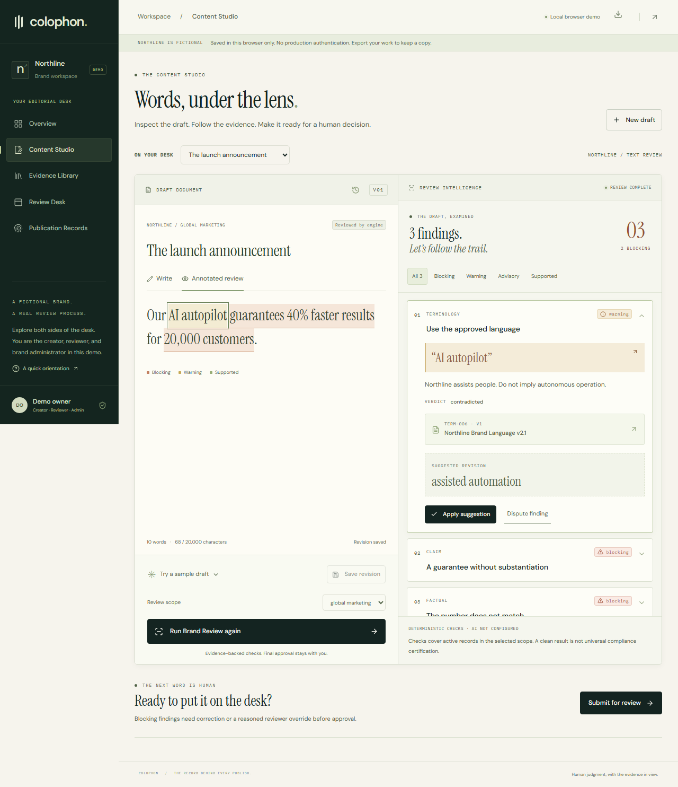

# Colophon

**The record behind every publish.**

Colophon is an evidence-first brand governance application built for CodeNexus India 2026, Round 2. Review text against approved facts, terminology, claim policies, and tone guidance. Inspect exact findings and their sources, correct a revision, make an explicit human decision, and keep its Publication Record.

Team: **SCHRODINGERS CODE** · Participant: **Kanishk Rungta**

Source: [Kanishk-Rungta/Colophon](https://github.com/Kanishk-Rungta/Colophon) · Live: [colophon-one.vercel.app](https://colophon-one.vercel.app)

## Start locally

Use Node.js **24.x** and npm. The lockfile is committed.

```powershell
npm.cmd ci
npm.cmd run dev
```

On macOS/Linux, use `npm ci` and `npm run dev`. On Windows with restrictive PowerShell execution policy, `.cmd` avoids invoking `npm.ps1`.

Open **http://localhost:3000**. The workspace is at **http://localhost:3000/demo**, and Content Studio at **http://localhost:3000/demo/studio**. No `.env` file, signup, database, or AI key is needed for the default demo. All Northline statistics and sources are fictional.

## What works



- Editorial landing page, workspace overview, split-view Content Studio, searchable Evidence Library, dedicated Review Desk, and printable/exportable Publication Records.
- Case-insensitive terminology, exact repeated spans, subject-aware numerical contradictions, unsupported guarantee patterns, advisory tone guidance, and approved/effective/unexpired evidence filtering by scope.
- Four verdicts: supported, contradicted, insufficient evidence, advisory. No opaque brand score.
- Evidence creation, editing, archiving, and version snapshots. New evidence defaults to draft; demo administrators explicitly approve it.
- Precise suggestion patches, manual edits, immutable saved revisions, previous-version restore as a new draft, and rescanning.
- Creator disputes, reviewer overrides with required reasons, request-changes feedback, explicit human approval, SHA-256 text fingerprint, and persisted decision/audit history.
- Browser-local persistence with failure reporting, workspace export, cross-tab revision checks, and an optional Supabase server implementation.
- Keyboard focus states, labelled fields, native modal dialogs, reduced-motion support, and mobile navigation/stacked review layouts.

## Two execution modes

| | Default local demonstration | Optional hosted Supabase mode |
|---|---|---|
| Storage | This browser's localStorage | PostgreSQL JSONB workspace state |
| Identity | Generated demo owner ID | Anonymous Supabase Auth user |
| Isolation | Separate browser storage contexts | Membership checks + database RLS |
| Approval permissions | Demo-domain checks in browser; user can edit storage | Server-validated identity and membership roles |
| AI | Deterministic checks only; no draft transmission | Optional server-side structured analysis |
| Verification status | Automated domain and browser verification | Live workflows, isolation, permissions, and concurrency tested |

**Local storage is not a production database or authorization boundary.** Tabs in one browser profile intentionally share a workspace. Private/incognito contexts are independent. Browser data can be cleared or edited by its owner. Export JSON before clearing storage. Storage failure never produces a fake success. No cross-device synchronization or record-import UI is included.

## Environment

Copy `.env.example` to `.env.local` only when enabling optional services. Do not commit secrets.

| Variable | Purpose |
|---|---|
| `NEXT_PUBLIC_SUPABASE_URL` | Optional Supabase project URL |
| `NEXT_PUBLIC_SUPABASE_ANON_KEY` | Optional public project key |
| `SUPABASE_SERVICE_ROLE_KEY` | Server secret; required with the two above for hosted persistence |
| `AI_PROVIDER` | `openai` to enable the implemented hosted adapter |
| `AI_API_KEY` | Server-only optional provider key |
| `AI_MODEL` | Available structured-output-capable model from your account |

All three Supabase variables are required together; partial configuration is an explicit error. Hosted state is not silently downgraded to local storage if the database fails. The optional AI adapter uses strict JSON Schema, exact span/reference validation, no mutation tools, a timeout, and advisory-only observations. It is not claimed as live-provider-tested without credentials.

## Supabase, migrations, and seeding

See [deployment instructions](docs/DEPLOYMENT.md). Apply [001_workspace.sql](supabase/migrations/001_workspace.sql) and enable anonymous sign-ins. Each session receives an independent Northline seed through idempotent initialization. No shared global mutable demo workspace is used. Client database roles cannot write directly. API identity is validated with `getUser()` and memberships are read on the server.

The Round 2 schema intentionally uses a versioned aggregate with explicit entity IDs instead of twelve normalized tables. See [architecture](docs/ARCHITECTURE.md) for relationships, concurrency, history guards, and scaling limits. The public deployment uses project `tquqrwrudzxnlpqcpqoq`; migration `001` is applied and tracked. See the [live verification report](docs/AUTOMATED_DEPLOYMENT_REPORT.md).

## Judge workflow

1. Open the demo workspace and start a brand review.
2. Load **The launch announcement**: `Our AI autopilot guarantees 40% faster results for 20,000 customers.`
3. Run Brand Review. Inspect `TERM-006`, `CLAIM-004`, and `FACT-021`, including their exact phrases and source metadata.
4. Apply a suggestion or edit manually. Each suggestion preserves the previous version and creates a fresh revision requiring a rescan.
5. Try the **Compliant baseline** sample, or write: `Our assisted automation helps teams move faster. Trusted by more than 12,000 customers.` Save and rescan.
6. Submit for review. Open Review Desk. You remain the same demo owner, now acting as reviewer.
7. Add a decision note and explicitly approve the exact version. Blocking findings require corrections or individual reasoned overrides. Request changes is also functional.
8. Open the Publication Record. Inspect source snapshots, findings, earlier versions, exceptions, approval, audit events, and content hash. Print or export JSON.

A clean scan means no issues were found by the configured checks, not universal compliance certification.

## Validation

```powershell
npm.cmd test
npm.cmd run evaluate
npm.cmd run typecheck
npm.cmd run lint
npm.cmd run build
npx.cmd playwright install chromium
npm.cmd run test:e2e
```

If Chrome is already installed, `$env:PLAYWRIGHT_CHANNEL='chrome'` selects it on Windows (or `PLAYWRIGHT_CHANNEL=chrome npm run test:e2e` on macOS/Linux). Playwright starts or reuses the local dev server and tests the judge journey plus 390×844, 768×1024, 1280×800, and 1920×1080 layouts. Browser reports and traces are generated locally and ignored by Git. Screenshots in `artifacts/` are genuine test captures.

See [the verification report](docs/VERIFICATION.md) for actual executed results and limitations. The 28-sample regression set includes a deliberately uncovered arbitrary semantic claim to document the deterministic engine's scope. It is not a general accuracy benchmark.

Current hosted verification: **12 distinct browser tests passed against the public site**, covering the judge journey, evidence/review flows, four responsive widths, real RLS/session isolation, reviewer permissions, concurrent saves, and six-screen axe checks. **82 unit/integration tests, type checks, lint, and production build also passed.** Earlier local development and production runs each passed 14 browser tests and the dependency audit found zero vulnerabilities. Automated axe results do not establish full accessibility conformance. Live AI remains unevaluated.

## Production build and deployment

For the complete Windows 11/PowerShell setup, use [the detailed deployment guide](docs/DEPLOYMENT_GUIDE.md). It covers the actual Supabase schema, exact environment names, Vercel dashboard/CLI, automatic deployments from GitHub, and live isolation checks. [The deployment report](docs/AUTOMATED_DEPLOYMENT_REPORT.md) records the completed schema repair and live test results.

```powershell
npm.cmd run build
npm.cmd start
```

Import the repository into Vercel using the Next.js preset and Node 24.x. Empty environment variables deploy the working local-storage demo. Configure Supabase only after applying the migration. Follow the [deployment and hosted acceptance checklist](docs/DEPLOYMENT.md). The verified public deployment is [colophon-one.vercel.app](https://colophon-one.vercel.app). The initial database migration is already applied there; do not rerun it.

## Known limits

Deterministic checking targets explicit configured phrases and numbers directly before known subjects. It does not establish arbitrary semantic truth, legal compliance, or performance guarantees. It does not parse PDFs, images, spreadsheets, or full guidelines into facts. Claims-policy prose does not automatically compile into arbitrary executable rules. Scope inheritance, supersession chains, multiuser role management UI, provider quality evaluation, broader database integration tests, and high-volume history normalization remain pending. Anonymous demo owner intentionally has all three roles. JSON exports are backups/inspection artifacts; no import workflow is advertised.

## Submission and Round 3

- [Round 2 submission](docs/ROUND2_SUBMISSION.md)
- [Updated five-page submission PDF](output/pdf/colophon-round2.pdf)
- [Architecture](docs/ARCHITECTURE.md)
- [Deployment](docs/DEPLOYMENT.md)
- [Three Round 3 improvements](docs/ROUND3_IMPROVEMENTS.md): **Visual Brand Governance**, **Guideline Debt Analytics**, **Advanced Evidence Verification**.

Development assistance is disclosed in the submission document. No external customer use, certifications, or invented performance metrics are claimed.

To regenerate the PDF from the retained captures, install Python `reportlab` and run `python scripts/create_submission_pdf.py --unit-tests 82 --browser-tests 14 --live-browser-tests 12`, replacing those counts only with newly verified results.
