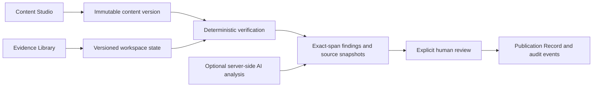

# Colophon architecture

Colophon is a single Next.js App Router application. Its core is a pure TypeScript command handler and deterministic verification engine shared by both execution modes.

## Data flow

## Domain

`lib/schema.ts` defines types and validates every command with Zod. `lib/domain.ts` implements permissions and state transitions. `lib/engine.ts` filters approved, effective, unexpired evidence by scope and returns precise UTF-16 spans. `lib/seed.ts` creates the fictional Northline library and draft. `lib/storage.ts` validates saved browser data and key relationships before rendering.

Workspace state contains explicit entities: evidence records and revisions, content items and immutable versions, scans and findings, decisions, publication records, and append-only audit events. IDs connect each scan to a version and each decision to the exact version approved. Findings preserve evidence snapshots. A Publication Record copies the approved version, final scan, decision, earlier revisions/scans, and relevant audit history; later edits never mutate these snapshots.

`draft → scanned → in_review → approved / returned`. Returned content must be saved and scanned again before resubmission. Saving after approval creates a new draft. Submitting with blockers is allowed so a reviewer can inspect them, but approval is rejected until every blocker has a recorded reviewer override or the creator corrects and rescans. Creator disputes do not waive blockers. Active evidence revision changes and clock-based expiry invalidate scans at submission and approval.

## Execution modes

### Local browser demonstration (default and tested)

No environment configuration is needed. A fresh browser storage partition receives an independent UUID-based workspace. State is stored under `colophon.workspace.v1` in localStorage. Each mutation runs the real command handler. Data is persisted before the UI reports success; storage failures are surfaced. Where supported, Web Locks serialize writes between tabs, and revision checks detect stale state. Other tabs receive storage events.

The browser owner can modify their own storage and code. There is **no production security boundary, server authentication, or tamper-resistant audit** in this mode. Browser profiles isolate unrelated visitors; tabs in the same profile intentionally share a workspace. Use only fictional demo data. Export JSON to retain a copy. No local-mode draft text is transmitted to the AI endpoint.

### Hosted Supabase mode (implemented and live-tested)

All three Supabase environment variables must be configured. Partial configuration produces a visible error rather than silently changing storage modes. The browser obtains an anonymous Supabase session through `@supabase/ssr`. API Route Handlers construct a cookie-based server client and validate identity with `auth.getUser()`. Route Handlers can refresh cookies; no user-specific server-rendered content is cached. The server resolves membership and roles from the database, never from request metadata or a supplied workspace ID.

For Round 2, the database stores one versioned aggregate JSONB state per workspace rather than 12 normalized tables. `workspace_members` assigns roles. The service-role client is server-only; browser roles have read-only RLS policies and no direct writes. A transaction and advisory lock make demo initialization idempotent. Server mutations use compare-and-swap on the workspace revision. An SQL trigger rejects changes to existing content versions, publication records, decisions, evidence history, and audit prefixes. A database-backed limit permits 60 actions per identity per minute. POST mutations validate Origin and body size.

This path was tested against the public Vercel deployment and its connected Supabase project after migration `001` was applied. Actual session/RLS isolation, permissions, persistence, and optimistic concurrency checks passed. See [verification scope](VERIFICATION.md); this remains a Round 2 demonstration rather than an enterprise deployment.

## Verification coverage

- Case-insensitive literal terminology and tone phrases, Unicode word boundaries, all repeated occurrences.
- Numerical values immediately preceding a configured subject. Supports formatted decimals and conservative lower bounds (`more than`, `over`, `at least`). Unrelated numbers are ignored. Explicit approved wording is supported.
- Guarantee patterns governed by an active claims policy. Missing performance substantiation is `insufficient_evidence`, not a declaration of falsehood.
- Tone remains advisory. Fact conflicts and explicit guarantee-policy findings block approval; terminology warns.
- Supported facts are shown as observations and are excluded from issue totals.
- Exact patches validate offsets and original text; applying a suggestion creates a revision and clears current analysis.

Coverage is deliberately narrow. Numbers written as words, `12k`, reverse-order subjects, multilingual semantics, and arbitrary unsupported superlatives are outside deterministic matching. A configured claim-policy record governs the built-in guarantee-pattern checker; its prose is not automatically compiled into arbitrary rules. Multiple active facts for the same subject can yield conflicting findings and should be avoided by administrators. Scope matching is exact, with `*` supported; global marketing is not automatically inherited by regional/email scopes.

## Optional AI

`lib/ai.ts` supports the OpenAI Chat Completions API with strict JSON Schema output and Zod validation. Set `AI_PROVIDER=openai`, `AI_API_KEY`, and `AI_MODEL` to an available structured-output-capable model. Only hosted server scans invoke it. It receives the draft and at most 40 applicable records, without session identity, tools, or mutations. Timeout: 15 seconds. Claims must match exact source spans; every supplied evidence ID must exist in the active snapshot, and support/contradiction verdicts require a source.

All AI observations remain advisory. Schema/reference/span rejection, refusal, timeout, or provider failure retains deterministic results and gives an explicit availability message. Missing configuration does not call the provider. Live provider quality has not been evaluated without a key. Mocks test provider validation and failure behavior; these are not live-provider metrics.

## Frontend and presentation

Editorial serif headings, restrained green/obsidian surfaces, warm paper editing, fine source labels, and CSS provenance animation. Desktop uses a split studio; tablets and mobile stack the editor and findings. Mobile navigation opens an accessible labelled drawer; dialogs use native modal focus management and Escape handling. Reduced-motion disables animations and transitions. React escapes all pasted content; no imported HTML is executed.

## Deployment boundaries

Next.js runs on Vercel's Node.js runtime. Node 24 is recommended for tooling compatibility. The default demo needs no external infrastructure. Supabase state can grow as scans/audits accumulate; aggregate storage is suitable for this demo, not high-volume multiuser use. Row normalization, pagination, cleanup policies, broader concurrency testing, and durable database integration tests remain future production work.

## Primary implementation references

- [Next.js installation and compatibility](https://nextjs.org/docs/app/getting-started/installation)
- [Supabase SSR clients](https://supabase.com/docs/guides/auth/server-side/creating-a-client?framework=nextjs)
- [Supabase anonymous authentication](https://supabase.com/docs/guides/auth/auth-anonymous)
- [Supabase Row Level Security](https://supabase.com/docs/guides/database/postgres/row-level-security)
- [OpenAI structured outputs](https://developers.openai.com/api/docs/guides/structured-outputs)
