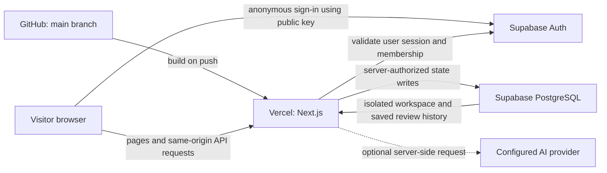

# Deploy Colophon from Windows 11

Repository: [Kanishk-Rungta/Colophon](https://github.com/Kanishk-Rungta/Colophon)

Reviewed against the actual repository and official service documentation on 7 November 2026.

**Recommended path:** keep the code on GitHub, import that repository into Vercel, and connect the existing Supabase adapter to a dedicated Supabase project. Use the dashboard deployment in section F for the simplest first deployment. Sections B-E prepare the database and local application first.

**Current deployment:** https://colophon-one.vercel.app is verified with hosted Supabase project `tquqrwrudzxnlpqcpqoq`. Migration `001` is already applied and tracked there; do not apply the initial SQL again. The guide below also covers setup of a separate fresh project. Replace example project references and domains with values from the intended dashboard. No secret values belong in Git or a chat message. See the [completed deployment report](AUTOMATED_DEPLOYMENT_REPORT.md).

## A. Architecture overview



### What is actually in this repository

| Component | Implementation | Runs where |
|---|---|---|
| Product interface | Next.js 16.4.5, React 19.3.1, TypeScript, custom CSS | Vercel serves the application; browser runs interactive components |
| Server endpoints | `app/api/health/route.ts`, `app/api/workspace/route.ts` | Vercel Node.js runtime |
| Verification and workflow | `lib/engine.ts`, `lib/domain.ts` | Server in hosted mode; browser in local demo mode |
| Authentication and persistence | `lib/server.ts`, `components/workspace-provider.tsx` | Supabase Auth plus server-side membership/permission checks |
| Database setup | `supabase/migrations/001_workspace.sql` | Supabase PostgreSQL |
| Optional AI | `lib/ai.ts` | Server only; never required for the judge workflow |

There are **three SQL tables**, not twelve: `workspaces`, `workspace_members`, and `action_limits`. A workspace stores a versioned JSONB aggregate containing evidence and evidence versions, content items and versions, scans and findings, resolutions, review decisions, publication records, and audit events. Stable IDs relate those domain entities. Preserve this model when applying the existing migration; do not create duplicate tables from an unrelated tutorial.

The database migration enables RLS and gives browser database roles read-only access under membership policies. The server validates the Supabase user, resolves their membership, runs domain permissions/validation, and uses a server-only privileged key to persist the result. The privileged key is necessary for this implementation's server-only write model; do not expose it or add public write policies to bypass an error.

An anonymous visitor is a real Supabase Auth user with an isolated workspace. The demo owner deliberately holds creator, reviewer, and administrator roles so one judge can complete both sides of the workflow. This does not represent three different people.

If all three Supabase variables are empty, Colophon runs its existing browser-storage demonstration. If only some are set, it reports an error. **For the database-backed deployment requested here, configure all three and confirm `/api/health` reports `hosted`.** That endpoint checks configuration presence, not database connectivity; opening and saving the actual workspace is the database test.

## B. Prerequisites and terminal setup

### 1. Open the correct directory

In VS Code, open the existing `C:\Users\Acer\Desktop\Colophon` folder. Open **Terminal → New Terminal**, select PowerShell, then run:

```powershell
Set-Location -LiteralPath 'C:\Users\Acer\Desktop\Colophon'
git status
git branch --show-current
git remote -v
```

Expected branch: `main`. Expected origin: `https://github.com/Kanishk-Rungta/Colophon.git`. Do not initialize another repository.

### 2. Check Node, npm, and Git

```powershell
node --version
npm.cmd --version
git --version
Get-Command node | Select-Object -ExpandProperty Source
where.exe node
```

Use **Node.js 24.x**. The package requires Node 24 or later, and Node 24 is the intended Vercel setting. If you see Node 22 or multiple installations, select Node 24 in your version manager or install the Node 24 release from [nodejs.org](https://nodejs.org/en/download), restart VS Code, and check again. A terminal opened before installation may retain its old PATH. If using `fnm`, install/select 24 with `fnm install 24` and `fnm use 24`, then verify the result.

Install Git from [git-scm.com](https://git-scm.com/downloads/win) if it is missing. Use `npm.cmd` and `npx.cmd` in these instructions; they avoid PowerShell's blocked `npm.ps1` execution-policy path. There is no need to relax the machine-wide execution policy just to run npm.

### 3. Confirm GitHub access

```powershell
git ls-remote origin refs/heads/main
```

This confirms repository readability. Writing requires your normal Git Credential Manager/GitHub authentication. The repository already has the owner's local Git identity. Do not replace it with a guessed email. A later `git push` may open GitHub's normal authentication flow.

### 4. Check deployment tools without global installation

```powershell
npx.cmd vercel --version
npx.cmd supabase --version
```

Allow npx to install the tools when prompted. Vercel CLI 65.12.1 and Supabase CLI 3.0.0 were available during the audit; future versions can change prompts. Use `npx.cmd vercel <command> --help` or `npx.cmd supabase <command> --help` if the installed version differs.

The Vercel dashboard path does not require Vercel CLI login. The Supabase SQL Editor migration path does not require Supabase CLI or Docker. Hosted CLI migrations need Supabase account access and the database password; running a full local Supabase stack additionally requires Docker Desktop, which is not necessary for this deployment.

### 5. Sign in only when using the CLI paths

```powershell
npx.cmd vercel login
npx.cmd vercel whoami
npx.cmd supabase login
npx.cmd supabase projects list
```

Complete browser authentication or enter a requested access token only into the tool's private terminal prompt. Verify the selected account owns the intended projects. Do not put tokens in command-line arguments, source files, or screenshots.

## C. Supabase project, authentication, and migration

### 1. Reuse a suitable project or create a dedicated one

1. Visit [the Supabase dashboard](https://supabase.com/dashboard) and sign in.
2. Inspect your existing projects. Reuse a dedicated Colophon project if one already exists and is suitable. Do not apply this initial schema blindly to a project containing unrelated production data.
3. Otherwise select **New project**, choose your organization, and name the project `colophon` or another clearly identifiable name.
4. Create a strong database password and save it in your password manager. This is the PostgreSQL password, not an API key, and the application does not need it as a runtime environment variable.
5. Choose the nearest available appropriate region for your intended users; for an India-focused demonstration, select an available nearby region. Match your Vercel function region to it when practical. Do not assume a particular region is available on every plan.
6. Stay on a free option if that is your intended budget. Do not upgrade plans or enable paid resources accidentally.
7. Wait until the project is ready.

### 2. Find the URL and keys

Open the project's **Connect** dialog for its API URL/public connection details. Open **Settings → API Keys** to see all available keys. Dashboard wording may change; the official [API keys guide](https://supabase.com/docs/guides/api/api-keys) is the reference.

The current Supabase recommendation is a **publishable key** for browser components and a **secret key** for the server. This repository retains the older environment-variable names. Keep the exact names expected by its code:

| Dashboard value | Existing Colophon variable |
|---|---|
| Project URL, usually `https://<project-ref>.supabase.co` | `NEXT_PUBLIC_SUPABASE_URL` |
| Publishable key, or an existing supported legacy `anon` key | `NEXT_PUBLIC_SUPABASE_ANON_KEY` |
| Server secret key, or an existing supported legacy `service_role` key | `SUPABASE_SERVICE_ROLE_KEY` |

The variable names do not change the key's privileges. The publishable key identifies the application; the user's JWT and RLS determine which user data can be read. A secret/service-role key bypasses RLS and must remain server-only. The installed SDK uses the provided key; compatibility with your actual project must still be checked by the hosted workflow. If you are following a legacy-key setup, find that pair in the dashboard's legacy API-key section rather than inventing a key.

Do not rename the variables to `NEXT_PUBLIC_SUPABASE_PUBLISHABLE_KEY` or `SUPABASE_SECRET_KEY` unless you also deliberately update the application: the current source does not read those names.

### 3. Enable anonymous sign-ins

1. Open **Authentication** in the project navigation.
2. Open **Sign In / Providers** (or the equivalent sign-in configuration screen).
3. Find **Anonymous Sign-Ins**, enable it, and save.
4. Leave the ordinary signup functionality needed for anonymous sign-in enabled. Email confirmation is not part of this demo's anonymous flow.
5. Under **Authentication → URL Configuration**, set **Site URL** to your actual production HTTPS origin once Vercel provides it. During local setup, `http://localhost:3000` is a development origin. Add only the development/preview redirect URLs you actually need; the anonymous flow does not need an OAuth redirect provider.

Reference: [Supabase anonymous authentication](https://supabase.com/docs/guides/auth/auth-anonymous). Anonymous users cannot recover their old identity after clearing the session or using a different browser/device. Database persistence does not automatically create a cross-device account-recovery feature.

Supabase applies anonymous-auth rate limits. Repeated automated tests create anonymous users, so avoid repeatedly running large suites from one IP. This app does not currently collect a CAPTCHA token. If you enable mandatory CAPTCHA/Turnstile, integrate that token into the sign-in flow before expecting the existing one-click demo to work. Do not disable RLS to fix an authentication problem.

### 4. Apply the existing migration: choose ONE path

#### Path A: SQL Editor — simplest for first setup

1. In VS Code open `supabase/migrations/001_workspace.sql` and review it. It creates the application's tables/functions/policies; it does not drop existing tables.
2. In the dedicated Supabase project, open **SQL Editor → New query**.
3. Paste the complete SQL migration, save it with an identifiable name, and click **Run**.
4. Confirm success. If it reports that a table/function already exists, stop and inspect the existing schema. Do not drop it or rerun pieces indiscriminately.
5. Continue with the verification queries below.

Apply the file once. This initial migration is not written as an endlessly repeatable `CREATE IF NOT EXISTS` script. Its demo-seeding RPC is idempotent; that is a separate concern from rerunning schema creation.

#### Path B: Supabase CLI — tracked migration history

From the project root:

```powershell
npx.cmd supabase login
npx.cmd supabase projects list
Test-Path -LiteralPath 'supabase/config.toml'
```

If the configuration file does not exist, initialize CLI configuration without replacing the existing migration:

```powershell
npx.cmd supabase init
```

With Supabase CLI 3, database commands default to local unless you select a remote target. Use the exact project reference from the dashboard explicitly:

```powershell
npx.cmd supabase migration list --remote=YOUR_PROJECT_REF
npx.cmd supabase db push --remote=YOUR_PROJECT_REF --dry-run
```

Read the dry-run output. For a fresh dedicated project, it should propose the repository's `001_workspace.sql`. If it proposes anything unexpected or reports conflicting history, investigate before applying it. Enter a requested database password at the private prompt, not in an argument or Git file.

Apply and confirm history:

```powershell
npx.cmd supabase db push --remote=YOUR_PROJECT_REF
npx.cmd supabase migration list --remote=YOUR_PROJECT_REF
```

Do not run `db reset` against the hosted project. Do not use `config push` merely to enable anonymous sign-in: it can push other local authentication/settings defaults too. Set that specific option in the dashboard unless you have reviewed the complete configuration diff.

If you already used SQL Editor, a later CLI may not know the migration was applied. Compare the complete schema with the file first. Only after confirming an exact match, use the documented `supabase migration repair 001 --status applied --remote=YOUR_PROJECT_REF` workflow to record it as applied. Do not use repair to conceal a failed or partial migration. Reference: [Supabase CLI](https://supabase.com/docs/reference/cli/introduction).

If database login-role initialization stalls, stop the command and inspect the project rather than resetting it. The authenticated management-query path can execute reviewed SQL without a direct database connection:

```powershell
npx.cmd supabase db query --remote=YOUR_PROJECT_REF --read-only --file supabase/verify.sql
```

For a fresh schema, apply the reviewed migration transactionally through SQL Editor or the management API. Applying SQL outside the migration runner does not automatically record CLI history: reconcile history only after confirming the complete schema matches. The existing production project's `001` migration and its source statements are already recorded.

### 5. Verify schema, RLS, and functions

Run these read-only SQL queries in SQL Editor:

```sql
select tablename, rowsecurity
from pg_tables
where schemaname = 'public'
  and tablename in ('workspaces', 'workspace_members', 'action_limits')
order by tablename;

select tablename, policyname, roles, cmd, qual
from pg_policies
where schemaname = 'public'
  and tablename in ('workspaces', 'workspace_members', 'action_limits');

select to_regprocedure('public.initialize_demo(uuid,uuid,jsonb)') as initialization_rpc,
       to_regprocedure('public.consume_action(uuid)') as limiter_rpc;

select trigger_name, event_manipulation, event_object_table
from information_schema.triggers
where trigger_schema = 'public'
  and trigger_name = 'preserve_history';
```

Expected: all three tables have RLS enabled; own-membership and member-workspace select policies exist; both RPCs and the history trigger exist. `action_limits` intentionally has no public/authenticated policy, and browser roles intentionally have no direct write grants. An absence of write policies is part of the design.

SQL Editor runs with elevated project access. Seeing every row there does **not** prove that RLS works for ordinary visitors. Test real users as described in section I.

### 6. Verify seeding after opening the application

No manual global Northline seed insertion is required. The application creates a new workspace from `lib/seed.ts` for each authenticated visitor. Refreshing/repeated initialization should return that visitor's existing workspace.

After opening a hosted demo once, inspect **Table Editor → workspaces** and **workspace_members**, or run:

```sql
select id, owner_id, revision,
       jsonb_array_length(state->'evidence') as evidence_count,
       jsonb_array_length(state->'contents') as content_count,
       jsonb_array_length(state->'records') as publication_count
from public.workspaces;

select workspace_id, user_id, roles
from public.workspace_members;
```

The fresh Northline workspace should contain nine evidence records and one draft. After approval its publication count should increase. Different anonymous users should have different workspace IDs. Do not publish these private table contents as demonstration screenshots.

## D. Local and Vercel environment variables

### Exact variables read by the existing source

| Variable | Purpose / where obtained | Required? | Public or secret | Local / Vercel |
|---|---|---|---|---|
| `NEXT_PUBLIC_SUPABASE_URL` | Supabase project URL from Connect | Required for hosted mode | Public configuration | `.env.local` and intended Vercel environments |
| `NEXT_PUBLIC_SUPABASE_ANON_KEY` | Public/publishable or supported legacy anon key from API Keys | Required for hosted mode | Public; bundled into browser code | Both |
| `SUPABASE_SERVICE_ROLE_KEY` | Server secret or supported legacy service-role key from API Keys | Required for hosted mode | **Secret; server only** | Both, never `NEXT_PUBLIC_` |
| `AI_PROVIDER` | `openai` selects the implemented adapter | Optional | Provider name, not a credential | Both only when enabling AI |
| `AI_API_KEY` | Your provider account's API credential | Optional | **Secret; server only** | Both only when enabling AI |
| `AI_MODEL` | Model available to your account supporting the adapter's structured output | Optional | Model identifier | Both only when enabling AI |

`SUPABASE_ACCESS_TOKEN` is a Supabase CLI/management login credential, not an application variable. The database password is for PostgreSQL administration/migrations. Neither should be added to the public client or committed. Vercel login credentials likewise do not belong in the application environment.

### Create the ignored local file

```powershell
if (-not (Test-Path -LiteralPath '.env.local')) {
    Copy-Item -LiteralPath '.env.example' -Destination '.env.local'
}
code .env.local
```

Edit the file privately. Example placeholders only:

```dotenv
NEXT_PUBLIC_SUPABASE_URL=https://YOUR_PROJECT_REF.supabase.co
NEXT_PUBLIC_SUPABASE_ANON_KEY=YOUR_PUBLIC_OR_PUBLISHABLE_KEY
SUPABASE_SERVICE_ROLE_KEY=YOUR_SERVER_SECRET_KEY

# Leave AI empty for the initial deployment.
AI_PROVIDER=
AI_API_KEY=
AI_MODEL=
```

Do not leave literal placeholders in an actual deployment. Use values from the **same Supabase project**. Restart the Next.js development server after changing this file. Public variables are embedded during a production build, so changing them on Vercel requires a new deployment.

Confirm the file is ignored without displaying its values:

```powershell
git check-ignore .env.local
git status --short
```

Expected: `.env.local` is ignored and is not staged. `.vercel/` is also already ignored. If Supabase CLI initialization creates local state under `supabase/.temp/`, ensure that generated directory is ignored before staging changes. Preserve the actual migration/config files you intend to version.

## E. Local testing before deployment

### Install and run

```powershell
npm.cmd ci
npm.cmd run dev
```

Leave the server running in that terminal and open `http://localhost:3000`. If `npm ci` fails to unlink a Next.js SWC binary on Windows, stop the Colophon dev/production servers first; they may hold that native file open. Do not kill every Node process on the machine, because VS Code and other tools may use Node too.

In another terminal:

```powershell
Invoke-RestMethod -Uri 'http://localhost:3000/api/health'
```

For the intended database setup, `mode` must be `hosted`. Then open `/demo`, inspect Evidence Library, save a revision, and reload. A `hosted` health response alone does not prove the migration, credentials, Auth, or database writes work.

### Checks already defined in package.json

```powershell
npm.cmd test
npm.cmd run evaluate
npm.cmd run typecheck
npm.cmd run lint
npm.cmd run build
```

Previous implementation verification recorded **82 tests**, including **28 labelled regression samples**, plus a successful build/type/lint check. Rerun them on your environment; do not assume historical results are new results. Existing database route tests use mocks; they do not establish live RLS correctness.

### Browser tests: distinguish local from hosted mode

The full existing 14-test browser suite includes localStorage fault injection and localStorage-based isolation checks. Those specific tests are for the browser-storage demo. **Do not interpret their failure against hosted mode as proof that hosted persistence is broken, or their success locally as proof of hosted isolation.**

For the full local-mode suite, use a terminal/environment with the three Supabase variables empty and restart Next.js in that mode:

```powershell
npx.cmd playwright install chromium
npm.cmd run test:e2e
```

For the real hosted application, run the compatible central workflow test first, then perform the database/isolation checks in section I:

```powershell
$env:PLAYWRIGHT_BASE_URL = 'http://localhost:3000'
npm.cmd run test:e2e -- e2e/judge.spec.ts --grep 'complete judge journey'
```

If using installed Chrome instead of downloaded Chromium, set `$env:PLAYWRIGHT_CHANNEL = 'chrome'`. Tests create isolated browser contexts, which creates anonymous Auth users in hosted mode. Respect the project's anonymous signup rate limits.

### Test the optimized local build

Stop the dev server with Ctrl+C. Build and start:

```powershell
npm.cmd run build
npm.cmd start
```

Repeat the central workflow at `http://localhost:3000`. There is no need to configure a custom Vercel output directory or static export.

## F. Vercel dashboard deployment — recommended first deployment

### 1. Import the existing GitHub repository

1. Sign in at [vercel.com](https://vercel.com), ideally with the GitHub account that owns the repository.
2. Select **Add New → Project**.
3. In **Import Git Repository**, choose `Kanishk-Rungta/Colophon` and click **Import**.
4. If it is absent, use the GitHub account/permissions link to allow the Vercel GitHub App access to this repository. Grant the needed repository access; do not create a replacement repository.
5. Choose the intended personal/team account. Confirm the plan and avoid enabling paid add-ons unintentionally.

### 2. Use these project settings

| Setting | Value |
|---|---|
| Project name | `colophon`, or another available clear name |
| Framework preset | **Next.js** |
| Root directory | Repository root `.` |
| Install command | Default npm detection, or `npm ci` |
| Build command | Default Next.js detection, or `npm run build` |
| Output directory | **Default**; do not set `out` or a static site directory |
| Development command | Default, or `npm run dev` |
| Node.js version | **24.x** in the project's build/runtime settings |
| Production branch | **main** |

This is a standard Next.js project. A `vercel.json` file is not required just to express these defaults. Do not add `output: 'export'`: the hosted app uses runtime server routes, session validation, and private database writes.

### 3. Add the hosted environment variables BEFORE deploying

Expand the import screen's **Environment Variables**, or open **Project → Settings → Environment Variables**:

1. Add `NEXT_PUBLIC_SUPABASE_URL` with the real project URL.
2. Add `NEXT_PUBLIC_SUPABASE_ANON_KEY` with its public/publishable key.
3. Add `SUPABASE_SERVICE_ROLE_KEY` with its server secret; mark it sensitive where the dashboard offers that control.
4. Select **Production**. For this fictional demo you may also configure **Preview** and **Development** against the same dedicated demo project. For real/private organizational data, use a separate reviewed preview database instead.
5. Leave the three AI variables empty initially. The deterministic workflow is sufficient.

Do not paste an entire `.env.local` into a public issue or GitHub README. Do not put the server key under a name starting with `NEXT_PUBLIC_`.

### 4. Deploy and inspect the result

Click **Deploy**. Follow **Build Logs**. A successful build should detect Next.js and build pages plus `/api/health` and `/api/workspace`. Wait for a **Ready** deployment; a failed build is not a live application.

Open the deployment, find its **Domains**/production domain, and copy the actual stable HTTPS URL. The name Vercel assigns may differ from your project name; do not assume a particular `colophon-....vercel.app` address exists.

Set Supabase's Site URL to this production origin. Open `<actual-origin>/api/health`; verify `hosted`, then run section I. Direct navigation to `/demo/studio`, `/demo/review`, and `/demo/records` should work on Vercel without GitHub Pages path workarounds.

### 5. Confirm public access

Open the production URL in an incognito/private window where you are **not signed in to Vercel**. If Vercel requires login, open **Project → Settings → Deployment Protection** and adjust the protection scope so the intended production domain is publicly accessible. Keep preview protection where appropriate. Do not ask judges to use your Vercel session or a private bypass token.

Reference: [Vercel deployment protection](https://vercel.com/docs/deployment-protection).

### 6. Redeploy after environment changes

Saving an environment variable does not replace an existing build. After changing public keys or other deployment settings, open **Deployments**, choose the intended branch/deployment, and select **Redeploy**; check that the new production deployment uses the intended environment. Repeat public access and workspace tests.

## G. Vercel CLI deployment — alternative or future maintenance

Use the CLI from the same repository root. There is no need for a global install:

```powershell
npx.cmd vercel login
npx.cmd vercel whoami
npx.cmd vercel link
```

In `link`, select the correct account/team, select the **existing** imported Colophon project if you used section F, and confirm the repository root. Create a new project only if none exists. The generated `.vercel/` link is local and ignored by Git.

Check names/scopes of configured variables without printing their values:

```powershell
npx.cmd vercel env ls
```

If not using the dashboard, add each variable through the CLI's interactive value prompt:

```powershell
npx.cmd vercel env add NEXT_PUBLIC_SUPABASE_URL production
npx.cmd vercel env add NEXT_PUBLIC_SUPABASE_ANON_KEY production
npx.cmd vercel env add SUPABASE_SERVICE_ROLE_KEY production --sensitive
```

Check `npx.cmd vercel env add --help` if your installed version changes sensitive-variable options. Prefer the dashboard's sensitive-entry control if your terminal visibly echoes input. Do not put the key itself on the command line. Repeat for `preview` only if that environment's database access has been intentionally configured.

Deploy a preview, test it, then deploy production:

```powershell
npx.cmd vercel deploy
npx.cmd vercel deploy --prod
```

The first command creates a preview deployment; `--prod` targets the production environment/domain. Neither command substitutes for a successful Supabase migration or a public-access test. Use the exact returned URL, and inspect it with:

```powershell
npx.cmd vercel inspect YOUR_ACTUAL_DEPLOYMENT_URL
```

Keep Supabase project variables configured in both intended environments. If a preview is protected, verify it through your authorized session; the final production URL must still work without that session.

Reference: [Vercel CLI deployment](https://vercel.com/docs/projects/deploy-from-cli) and [environment commands](https://vercel.com/docs/cli/env).

## H. Automatic deployments from GitHub

Importing `Kanishk-Rungta/Colophon` into Vercel establishes the normal Git integration. This is how to deploy “using GitHub” while retaining Next.js server functionality. GitHub stores the source; Vercel runs the app and its backend. GitHub Pages alone cannot run these server routes.

Verify **Project → Settings → Git** shows the correct repository, and verify the production branch is `main` in the production environment/branch settings. If you created the Vercel project through CLI without a Git connection, link it using the dashboard or:

```powershell
npx.cmd vercel git connect https://github.com/Kanishk-Rungta/Colophon.git
```

After connection:

- A push/merge to `main` builds and deploys production.
- Other branch/PR pushes can create preview deployments using Preview environment variables and protection settings.
- Build failures appear in Vercel's deployment logs and the GitHub commit/PR checks.
- No GitHub Actions YAML is required for this standard Vercel integration.

For a future code change:

```powershell
git switch -c fix/example-change
# Edit the relevant source files in VS Code.
npm.cmd test
npm.cmd run typecheck
npm.cmd run lint
npm.cmd run build
git add PATHS_YOU_REVIEWED
git commit -m "fix: describe the actual change"
git push -u origin fix/example-change
```

Open a PR, test its preview, and merge into `main` when appropriate. Do not literally use the placeholder `PATHS_YOU_REVIEWED` or stage secrets.

If a release breaks the application, use the Vercel dashboard's rollback action to select a known-good deployment, or consult `npx.cmd vercel rollback --help` for the installed CLI. An application rollback does not undo a database migration or restore deleted data. Fix the code and deploy again; use a reviewed forward database migration when necessary. See [GitHub integration](https://vercel.com/docs/git/vercel-for-github) and [rollback documentation](https://vercel.com/docs/instant-rollback).

## I. Production verification checklist

Set the actual origin in a PowerShell variable, without a trailing slash:

```powershell
$colophonUrl = 'https://YOUR_ACTUAL_PRODUCTION_DOMAIN'
(Invoke-WebRequest -Uri $colophonUrl -UseBasicParsing).StatusCode
Invoke-RestMethod -Uri "$colophonUrl/api/health"
```

Expected landing response: HTTP 200. Expected configured mode: `hosted`. A response containing `local` means the production deployment is using browser storage, not the requested database backend. A Vercel authentication page is not the application's landing page, even if that login page returns HTTP 200.

### 1. Complete the actual judge journey

Use a clean private session with no Vercel login:

1. Open the production landing page. Check typography/layout and browser Console/Network for failed application requests.
2. Click **Open the demo workspace**. Verify the storage indicator says **Isolated Supabase session**, not **Local browser demo**.
3. Open Evidence Library. Verify Northline sources including `FACT-021`, `TERM-006`, and `CLAIM-004`, with validity metadata.
4. Open Content Studio and load the problematic sample: `Our AI autopilot guarantees 40% faster results for 20,000 customers.`
5. Run Brand Review. Expect terminology, unsupported guarantee/insufficient evidence, and numerical conflict findings. Inspect each source and precise phrase.
6. Apply the terminology suggestion. Confirm the intended phrase changes and a new revision is created. Edit the remaining copy, or load the compliant baseline, then save/rescan.
7. Verify the new findings correspond to the new text. Previous text should remain in revision history.
8. Submit for review. Open Review Desk. Confirm the exact revision being reviewed. Request changes once if testing that branch, then correct/save/scan/submit again.
9. Explicitly approve the corrected version. If blockers remain, approval must require corrections or individual reasoned overrides; a creator dispute alone must not bypass them.
10. Open Publication Records. Confirm approved text, version, policy/source versions, findings, decision, timestamp, and audit history.
11. Refresh. The same session's saved state/record must remain, backed by a workspace row in Supabase. Editing later must create a new draft without changing the previous approved record.
12. Test around 390px mobile width, 768px tablet, and desktop. Verify navigation, editor controls, dialogs, evidence details, and approval remain usable without horizontal overflow.

Do not label the public deployment verified until this succeeds at the real URL. The demo's clean scan covers configured rules, not every possible truth or legal requirement.

### 2. Prove independent sessions and direct API rejection

Two tabs in the same profile share one anonymous session by design. Use a normal browser profile for session A and an incognito or different browser/profile for B. Two incognito windows in the same browser may share their private session; use truly independent contexts.

In each session, open DevTools Console on the application and obtain non-secret identifiers:

```javascript
const response = await fetch('/api/workspace', { cache: 'no-store' });
const result = await response.json();
console.table({
  workspaceId: result.state.id,
  contentId: result.state.contents[0].id,
  revision: result.state.revision
});
```

Expected: different workspace/content IDs between A and B. Create a distinct draft title in A; it must not appear in B.

In B, use A's non-secret content UUID in a direct request. Take B's current revision from its own GET response:

```javascript
const own = await fetch('/api/workspace', { cache: 'no-store' }).then(r => r.json());
const denied = await fetch('/api/workspace', {
  method: 'POST',
  headers: { 'Content-Type': 'application/json' },
  body: JSON.stringify({
    revision: own.state.revision,
    command: { type: 'scan', contentId: 'SESSION_A_CONTENT_UUID' }
  })
});
console.log(denied.status, await denied.json());
```

Expected: content-not-found rejection, normally HTTP 404, never A's private content. The API does not accept a client-selected workspace or actor ID. `/demo/studio?id=SESSION_A_CONTENT_UUID` must likewise not load A's draft for B.

### 3. Test public-key database access under RLS

For a stronger check than UI visibility, create an ignored local file `tmp/verify-rls.mjs` with the following code. Replace only the non-secret foreign workspace UUID. This creates **one additional anonymous test user**; it does not delete any accounts or rows.

```javascript
import { createClient } from '@supabase/supabase-js';

const foreignWorkspaceId = 'SESSION_A_WORKSPACE_UUID';
const client = createClient(
  process.env.NEXT_PUBLIC_SUPABASE_URL,
  process.env.NEXT_PUBLIC_SUPABASE_ANON_KEY,
  { auth: { persistSession: false, autoRefreshToken: false } }
);
const signedIn = await client.auth.signInAnonymously();
if (signedIn.error) throw new Error('Anonymous test sign-in failed. Check Auth settings.');

const read = await client.from('workspaces').select('id').eq('id', foreignWorkspaceId);
if (read.error) throw new Error('RLS read could not be evaluated; inspect grants/policies.');
if (read.data.length !== 0) throw new Error('Isolation failed: foreign workspace visible.');

const write = await client.from('workspaces')
  .update({ revision: 0 }).eq('id', foreignWorkspaceId).select('id');
if (!write.error) throw new Error('Unexpected direct-write access; inspect grants.');

console.log('Foreign workspace hidden; direct browser-role writes rejected.');
```

Run it from the repository root so Node loads the ignored private environment file:

```powershell
node --env-file=.env.local tmp/verify-rls.mjs
```

Do **not** use the server secret in this client; that would bypass the RLS behavior being tested. The script never prints a JWT or API key. Also test that an API request without session cookies receives an authentication error rather than workspace data. Reference: [Supabase RLS](https://supabase.com/docs/guides/database/postgres/row-level-security).

### 4. Test the authorized reviewer restriction

In a disposable test session, note its Auth user UUID and existing membership roles in Supabase. Temporarily change only that test membership's roles to `['creator']` through the database administrator view. Attempt approval from that session: the server must reject it with 403. Restore the original roles afterward. Do not perform this against a judge's active workspace or another person's membership. The demo UI may still show controls; the important protection is server rejection.

### 5. Automate compatible workflow tests against production

With the production server already live:

```powershell
$env:PLAYWRIGHT_BASE_URL = $colophonUrl
npm.cmd run test:e2e -- e2e/judge.spec.ts --grep 'complete judge journey'
```

For broader hosted-compatible workflow coverage:

```powershell
npm.cmd run test:e2e -- e2e/judge.spec.ts --grep 'complete judge journey|blocking findings|request changes|evidence can|responsive judge workflow'
```

These selected tests use UI workflows and the production origin. The excluded localStorage-only tests are not hosted isolation tests. Keep the Supabase rate-limit budget in mind; repeated runs create users.

The dedicated hosted tests can also exercise real RLS/API isolation and concurrent saves:

```powershell
$env:COLOPHON_TEST_HOSTED = '1'
npm.cmd run test:e2e -- e2e/hosted.spec.ts
```

The third test is skipped unless `COLOPHON_TEST_ADMIN=1` and `COLOPHON_SUPABASE_PROJECT_REF` is explicitly set to the intended project. It requires an authenticated Supabase CLI, creates its own fictional test session, temporarily restricts only that membership to creator, verifies a rejected approval, and restores its demo roles. Leave this administrative test disabled for ordinary UI verification. Run Playwright processes sequentially or set distinct output directories to avoid trace-file collisions.

Remove test overrides when finished:

```powershell
Remove-Item Env:PLAYWRIGHT_BASE_URL -ErrorAction SilentlyContinue
Remove-Item Env:PLAYWRIGHT_CHANNEL -ErrorAction SilentlyContinue
Remove-Item Env:COLOPHON_TEST_HOSTED -ErrorAction SilentlyContinue
Remove-Item Env:COLOPHON_TEST_ADMIN -ErrorAction SilentlyContinue
Remove-Item Env:COLOPHON_SUPABASE_PROJECT_REF -ErrorAction SilentlyContinue
```

### 6. Test failure and AI fallback behavior

Keep AI configuration empty on the initial deployment and complete the full workflow. This demonstrates the required no-AI path. For a hosted outage test, use a separate preview/test environment rather than breaking production keys. A failed database operation must show an error and preserve previously saved state; it must not silently switch to local storage or report success. A configured provider timeout must preserve deterministic results and indicate AI unavailability.

## J. Troubleshooting

| Problem | Likely cause | Diagnose | Exact action |
|---|---|---|---|
| Build fails with an engine warning/error | Old Node in terminal or Vercel | `node --version`; Vercel Build Logs | Select Node 24.x, restart terminal, run `npm.cmd ci`, rerun checks/build |
| `npm.ps1` cannot run | PowerShell execution policy | Error names the `.ps1` shim | Use `npm.cmd` / `npx.cmd` commands from this guide |
| `npm ci` reports EPERM on SWC | Colophon server holds native compiler binary | Check your Colophon dev/start terminals | Stop those servers with Ctrl+C, close their child process if necessary, retry; do not terminate unrelated Node apps |
| Blank page | JavaScript/runtime or stale-build failure | Browser Console/Network, Vercel runtime logs | Identify the first actual failure, correct its source/configuration, redeploy; avoid resetting browser data as the first fix |
| 404 on application routes | Wrong deployment/domain, static output setting, or root directory | Open `/` and `/demo/studio`; inspect framework/root settings | Use Next.js preset, root `.`, default output; deploy the correct commit |
| 500 / operation failed | Missing migration, invalid key, or runtime database failure | Vercel runtime logs and Supabase logs; inspect failed API status | Correct the specific credential/schema issue; retry the real operation; don't replace it with fake data |
| Health shows `local` | All hosted variables absent from this build/environment | `/api/health`, Vercel variable names/scopes | Set the three exact Supabase variables for Production and redeploy |
| Health returns misconfiguration / 503 | Only some hosted values set | Environment variable names and scopes, without logging values | Set all three correctly, from the same project, then redeploy |
| Supabase connection error | Wrong project URL/key, paused/unavailable project | Project dashboard, failed Auth/Data request | Resume/repair the intended project and copy matching URL/keys; restart/redeploy |
| Anonymous sign-in fails | Provider disabled, signup blocked, CAPTCHA requirement, rate limit | Supabase Auth logs and response status | Enable Anonymous Sign-Ins, check signup/rate-limit settings; integrate CAPTCHA before requiring its token |
| RLS permission error | Missing/incorrect grants or migration changed | Inspect `pg_policies` and table grants; test as actual user | Restore reviewed migration policies/grants; keep RLS enabled; never use the server key in browser code |
| Demo does not initialize | Missing RPC/membership schema or wrong server secret | Check `initialize_demo`, `workspace_members`, API error | Apply the reviewed migration to the intended project and configure the privileged server key |
| Scan does not run | Blank/unsaved content, stale state, action limit, or provider latency | Inline error, API response, current version | Save valid content; run a fresh review; reload if a concurrent edit won; wait for rate-limit window if 429 |
| AI unavailable | No optional config, wrong model, timeout, or rejected output | Scan's method/availability label | Leave AI empty for deterministic demo, or set all optional server variables correctly; do not require AI to approve |
| Approval not saved | Open blockers, stale policy scan, missing reviewer role, DB error | Review Desk, API 403/409/503, membership | Correct/rescan or record each reasoned override; use assigned reviewer; retry only after the real cause is fixed |
| Publication Record missing | No explicit successful approval, wrong session, or failed write | Decision history, current session, database `state.records` | Confirm human approval completed in the same session; inspect failure before creating another record |
| Data disappears after refresh | Session lost, storage mode changed, different origin, cleared cookies | Storage indicator, Auth session, workspace IDs | Keep the same origin/session; verify hosted writes; old localStorage is not automatically imported into Supabase |
| Works locally, fails on Vercel | Variables only in local file; wrong environment/Node; old build | Compare variable names/scopes and build logs | Set Production values, Node 24.x, and redeploy the current commit |
| Judges see Vercel login | Production domain protected | Open in private browser without Vercel session | Adjust intended production access under Deployment Protection and retest |
| Saving returns 409 | Another tab saved first, or scan/policy became stale | API error and revision history | Preserve unsaved text, reload current state, reapply and rescan; do not overwrite the newer revision |
| API returns 429 | Database command rate limit or Auth rate limit | Identify whether failing request is app API or Auth | Wait for the relevant window; reduce repeated automated signup; inspect legitimate abuse controls |
| `db push` reports existing objects/history conflict | Migration applied manually or different schema | Compare SQL Editor schema and migration list | Reconcile schema/history deliberately; use repair only after verifying the migration already matches |

## K. Maintenance and safe future changes

### Code and deployment

Use small feature branches, run the existing checks, inspect a preview, and merge into `main`. Confirm the Vercel deployment's source commit matches the intended GitHub commit. Inspect **Build Logs** for compilation and the project's runtime **Logs/Observability** for API failures. Do not log document bodies, keys, cookies, or access tokens merely to debug an error.

### Environment changes

Change values in **Project → Settings → Environment Variables**, select the intended environments, and redeploy. Also update your private `.env.local` when needed. Server secrets must never receive `NEXT_PUBLIC_` names. Rotate a leaked key in Supabase/provider settings, update every intended Vercel environment, and redeploy; deleting a leaked line from a later Git commit does not revoke the old key.

### New database migrations

If using CLI history, create a new migration rather than editing an already applied one:

```powershell
npx.cmd supabase migration new describe_the_change
# Review and edit the generated SQL file.
npx.cmd supabase db push --remote=YOUR_PROJECT_REF --dry-run
```

Test it on a separate project/environment, review its effects, back up as appropriate, and only then run `npx.cmd supabase db push --remote=YOUR_PROJECT_REF` against the explicitly selected project. Prefer additive changes. Do not reset hosted data or drop tables to resolve a migration conflict.

The existing workspace aggregate is useful for this Round 2 demo, but histories grow as users scan/save. Monitor database/storage size and Auth-user growth in Supabase's usage reports. For a larger product, normalize/paginate histories, define retention policies, and add broader concurrency/security tests before claiming production scale.

### Anonymous-user retention

Anonymous Auth users and their database rows remain after their browser session disappears. The schema cascades deletion of an Auth user to their owned workspace/membership/action-limit rows, so deleting users can permanently remove publication/audit history. Define a retention policy first; review counts and backups before any cleanup. Do not schedule automatic destructive cleanup from a copied snippet. Supabase documents the current behavior and abuse considerations in its [anonymous-auth guide](https://supabase.com/docs/guides/auth/auth-anonymous).

### Secret and generated-file hygiene

Before each commit inspect `git status` and staged diffs. `.env.local` and `.vercel/` are already ignored. Keep project keys, database passwords, CLI tokens, and raw private workspace exports out of commits, issue bodies, screenshots, and logs. The public project URL and publishable key are designed for client use; that does not make the privileged key public.

## L. CodeNexus submission checklist

- The actual production HTTPS URL loads in an unauthenticated private browser.
- Hosted mode, anonymous seeding, persisted approval, and direct isolation checks succeed.
- The full content → scan → correction → rescan → review → human approval → Publication Record journey succeeds on the public site.
- The GitHub source URL remains `https://github.com/Kanishk-Rungta/Colophon` and judges have the required repository access.
- Keep `docs/ROUND2_SUBMISSION.md` aligned with the verified public URL and actual migration/test results. It currently records the verified Vercel/Supabase deployment.
- Keep `output/pdf/colophon-round2.pdf` aligned with the deployment report. It has been refreshed after live verification. Changing Markdown alone does not regenerate the PDF; use the documented script with actual test counts.
- List working features and the implemented aggregate/database architecture accurately. Keep AI optional and disclose live-provider limitations.
- The original Round 1 proposal was not supplied in this workspace, so compare your actual original submission before making claims about historical changes.
- Retain the three planned improvements: **Visual Brand Governance**, **Guideline Debt Analytics**, **Advanced Evidence Verification**.
- Team: **SCHRODINGERS CODE**. Participant: **Kanishk Rungta**. Preserve accurate significant-tool/AI-assistance disclosure in the event submission.

## M. Deploy Colophon in 10 Steps

1. Open this repository in VS Code and confirm Node 24.x, npm, Git, the `main` branch, and the existing GitHub origin.
2. Reuse or create the intended dedicated Supabase project without unintentionally enabling paid resources.
3. Apply and verify `supabase/migrations/001_workspace.sql` once, using SQL Editor or linked CLI history.
4. Enable anonymous sign-ins and collect the correct project URL, public key, and privileged server key privately.
5. Configure the three exact variables in ignored `.env.local`, run the app, and complete a hosted save/scan/approval/refresh test.
6. Run unit/type/lint/build checks; run compatible hosted browser tests and inspect errors.
7. Import `Kanishk-Rungta/Colophon` into Vercel with Next.js, root `.`, default output, Node 24.x, and production branch `main`.
8. Add the three Supabase variables to Production, leave AI empty initially, and deploy. Set the resulting actual HTTPS origin in Supabase URL configuration.
9. Open production without a Vercel session; verify the complete journey, persistence, two independent sessions, API/RLS isolation, and mobile layout.
10. Record the verified URL/results in the submission and PDF; maintain future deployments through reviewed GitHub pushes and Vercel logs.

There is no guaranteed time estimate: authentication, project provisioning, migrations, builds, and verification depend on your actual accounts and environment.
